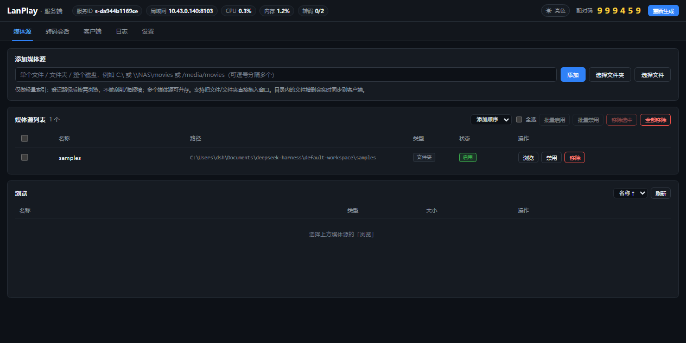
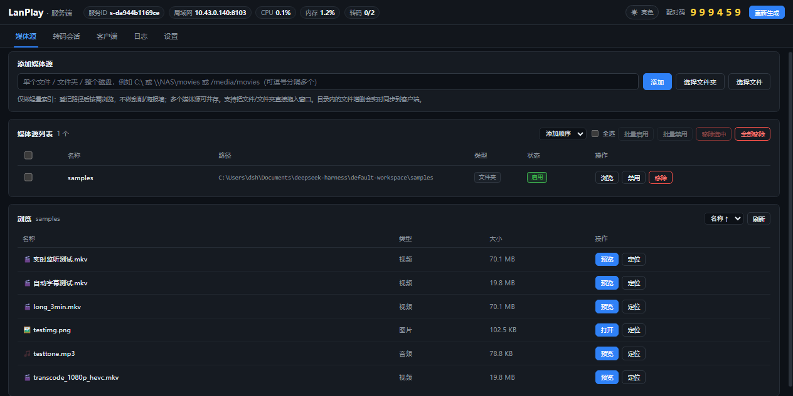
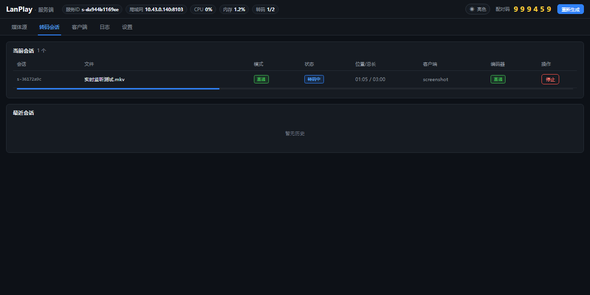
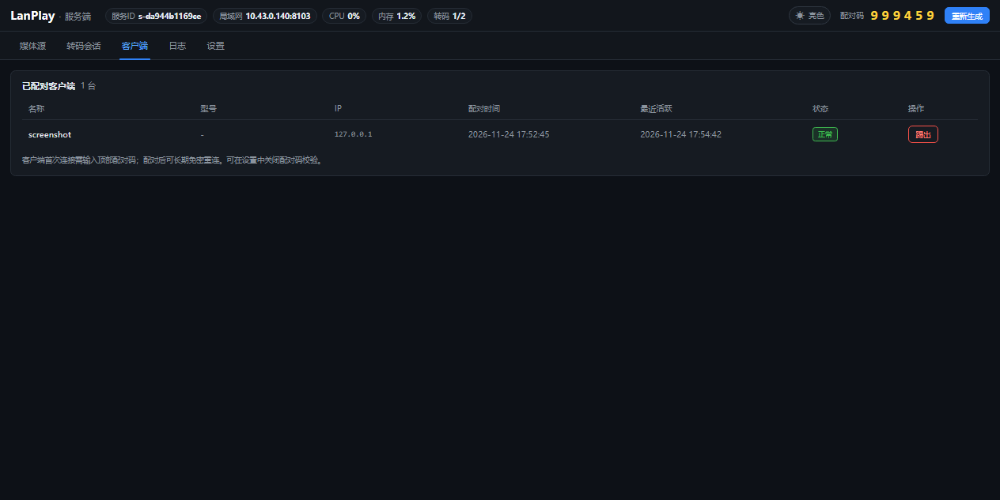
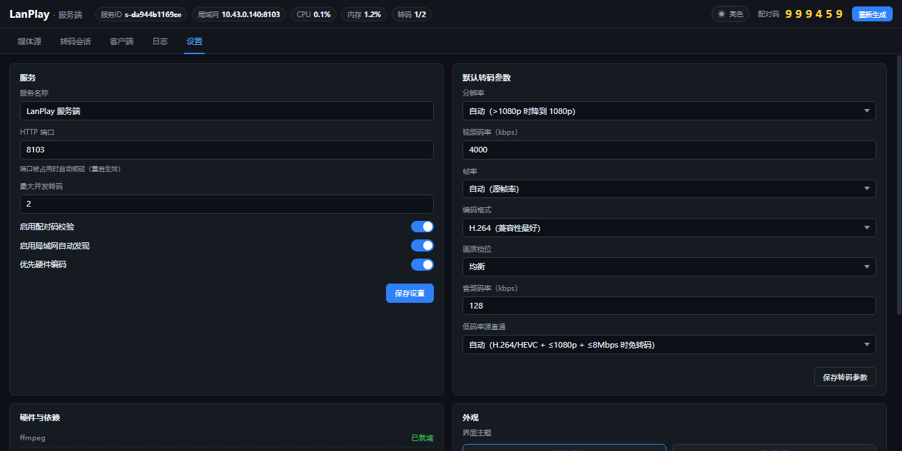
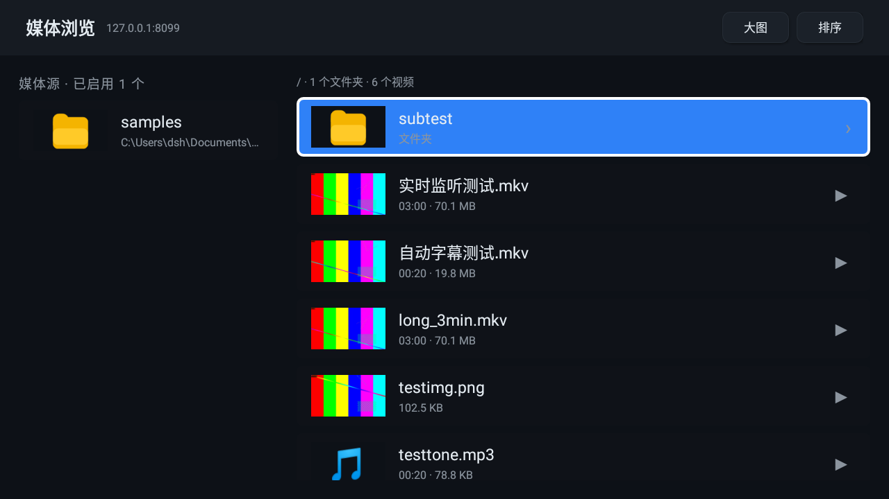
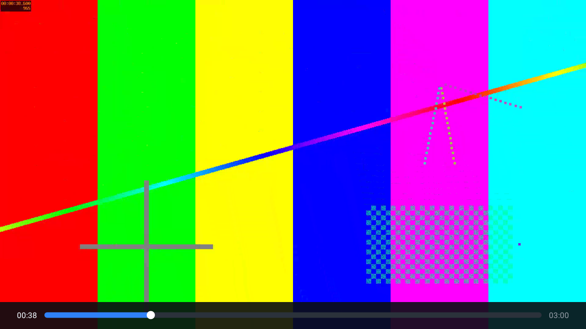

# LanPlay · 局域网媒体转码推流系统

<p align="center">
  
  <br><em>服务端：媒体源管理（拖拽导入 / 浏览 / 系统播放器预览）</em>
</p>

> 让投影仪（小明 Q1 等 Android 遥控器设备）流畅播放电脑上的高码率片源。
> 服务端负责解码/转码/字幕烧录/推流，客户端只拉低码率 HLS 流并做轻量渲染。

- **服务端**：Win64 绿色免安装（解压即用），Electron GUI，内置 ffmpeg
- **客户端**：Android（手机/平板/投影仪/TV 盒子），遥控器优先交互
- **传输**：HTTP 上的 HLS（`mpegts` 分片，2s/片），局域网内低延迟

## 它解决什么问题

低性能 Android 投影仪直接播放 SMB / 本地高码率视频（4K HEVC、高码率 H.264）时，
本地解码能力不足导致卡顿、卡死。LanPlay 把重活全部挪到电脑端：

```
电脑（服务端）                          投影仪（客户端）
┌────────────────────────┐            ┌──────────────────┐
│ 媒体源引用（本地/SMB）  │            │  只接收低码率流   │
│ ffmpeg 转码 → HLS 分片 │  ──局域网─▶│  ExoPlayer 渲染   │
│ 字幕提取/烧录          │            │  遥控器播放控制   │
│ 会话/进度/seek/倍速    │            │  字幕/音轨选择    │
└────────────────────────┘            └──────────────────┘
```

- 播放中快进/后退/拖动/倍速/切音轨/切字幕，全部由服务端重开转码实现，客户端零解码压力；
- 低码率源（H.264/HEVC ≤1080p ≤8Mbps）自动直通不转码，画质无损且 CPU 几乎为零；
- 文本字幕服务端转 WebVTT 客户端渲染，图形字幕（PGS）服务端烧录进画面。

## 界面一览

### 服务端

<table>
<tr>
<td align="center"><br><sub>目录浏览与文件列表</sub></td>
<td align="center"><br><sub>转码会话实时监控（直通/GPU/CPU 三态）</sub></td>
</tr>
<tr>
<td align="center"><br><sub>客户端连接状态与踢出</sub></td>
<td align="center"><br><sub>转码参数与主题设置</sub></td>
</tr>
</table>

### Android 客户端

<table>
<tr>
<td align="center"><br><sub>媒体浏览：左侧媒体源，右侧文件列表（遥控器焦点导航）</sub></td>
<td align="center"><br><sub>播放中：服务端转码推流，底部进度条，OK 键呼出控制栏</sub></td>
</tr>
</table>

---

## 一、项目结构

```
lanplay\
├─ dist\                        ← 构建产物（不入库）：LanPlay-win64\ 绿色版 + LanPlay-Client-1.0.0.apk
├─ server\                      ← 服务端源码（Electron 主进程 + HTTP/转码核心）
│  ├─ main.js                  Electron 入口（托盘、窗口、IPC）
│  ├─ preload.js               安全预加载脚本
│  ├─ standalone.js            无界面模式入口（node server/standalone.js）
│  └─ core\                    config / logger / library / watcher / ffmpeg / transcode /
│                              sessions / clients / http / gui-api / discovery / metrics
├─ gui\                         ← 服务端界面（原生 HTML/CSS/JS，无前端框架）
├─ android\                     ← Android 客户端源码（Kotlin + Media3/ExoPlayer + OkHttp）
├─ bin\                         ffmpeg.exe / ffprobe.exe（本地提供，不入库，打包时复制进 dist）
├─ tools\                       构建 / 回归 / 冒烟测试脚本
├─ docs\                        技术方案、验收报告、Android 验证报告、截图
└─ README.md
```

---

## 二、快速开始（使用成品包）

### 1. 启动服务端

1. 解压整个 `LanPlay-win64` 文件夹到任意位置（例如 `D:\LanPlay`）。
2. 双击 **`LanPlay.exe`**。首次启动会在同目录自动生成 `data\`（配置、日志、转码缓存）。
3. 界面右上角显示 **6 位配对码**，顶栏显示本机局域网地址（如 `192.168.1.10:8099`）。
4. 在「媒体源」页添加媒体：
   - 输入框粘贴路径 → **添加**（支持逗号分隔多个路径）；
   - 或点 **选择文件夹 / 选择文件**；
   - 或直接把文件/文件夹 **拖进窗口**（全窗口拖拽接收）。
5. 点引用根行尾的 **浏览** 进入目录；点视频/音频文件的 **预览** 会调用 Windows 系统默认播放器直接播放原文件（不经服务端转码），点 **定位** 在资源管理器中显示该文件。

### 2. 安装客户端

1. 把 `LanPlay-Client-1.0.0.apk` 拷到投影仪（U 盘 / `adb install`）。
2. 打开 LanPlay，客户端会自动广播搜索同一局域网内的服务端；
   也可在右侧手动输入 `192.168.x.x:8099`。
3. 首次连接输入服务端顶部 **配对码**，之后凭 token 免密重连。
4. 进入媒体浏览页：左侧选媒体源，右侧选目录或影片，OK 键播放。

### 3. 遥控器操作（客户端）

| 场景 | 按键 | 行为 |
|---|---|---|
| 浏览列表 | 方向键 / OK | 移动焦点 / 进入目录或播放 |
| 浏览列表 | 长按 OK（媒体源上） | 弹出菜单：禁用/移除/排序 |
| 浏览列表 | 返回 | 上一级目录；根目录再按退出 |
| 播放中（控制栏隐藏） | 左 / 右 | −10s / +30s 跳转 |
| 播放中 | OK / 菜单 / 上 / 下 | 呼出控制栏 |
| 控制栏 | 左右（焦点在进度条） | 步进 10s，**长按连续快进/快退** |
| 控制栏 | 暂停 / «10s / 30s» / 倍速 / 音轨 / 字幕 | 对应功能（倍速与音轨切换均由服务端重开转码） |
| 播放中 | 返回 | 停止会话并返回列表 |

### 4. 服务端界面概览

服务端界面共五个标签页：**媒体源**（引用管理/浏览/预览）、**转码会话**（实时进度/直通-GPU-CPU 三态/停止）、
**客户端**（在线状态/踢出）、**日志**（实时滚动/导出/清空）、**设置**（转码参数/直通开关/端口/发现/主题）。

服务端界面支持**深色 / 亮色**两套主题：顶栏「☀ 亮色」胶囊按钮、设置页「外观」预览块、
`Ctrl + Shift + L` 快捷键，或「跟随系统主题」随 Windows 深浅色自动切换。选择保存在本机，下次启动自动恢复。

---

## 三、功能对照（PRD → 实现）

### 服务端

| 编号 | 需求 | 实现情况 |
|---|---|---|
| S-01 | Win64 GUI，添加/移除单文件、多文件、文件夹、整盘、SMB 路径 | ✅ 输入框（逗号分隔多路径）、系统选择框、**全窗口拖拽**；引用根可启用/禁用/移除/排序 |
| S-02 | 轻量目录/引用源展示，不做刮削 | ✅ 按需 `readdir` 浏览 + ffprobe 元数据缓存，无海报墙 |
| S-03 | 媒体索引/刷新，客户端可列出 | ✅ `/api/roots`、`/api/browse`；目录变化 `fs.watch` 监听自动刷新（增量同步 `/api/sync`） |
| S-04 | GPU 优先硬编，失败回退 CPU | ✅ 启动时逐个真实试转探测 NVENC/QSV/AMF/MF；会话内硬编失败自动重启为 libx264 |
| S-05 | 分辨率/码率/帧率/编码/画质档位，默认自适应 + 手动 | ✅ 设置页「默认转码参数」；客户端播放请求可覆盖 |
| S-06 | 内嵌字幕轨提取、外挂字幕、客户端选择；图形字幕服务端烧录 | ✅ 文本字幕转 WebVTT 由客户端渲染；PGS/VobSub 走 `overlay` 烧录并重开会话 |
| S-07 | 会话管理：开始/停止/进度/连接状态/异常提示 | ✅ 「转码会话」页实时进度条 + 最近会话 + 错误摘要；「客户端」页在线状态与踢出 |
| S-08 | seek（快进/快退/拖动） | ✅ `POST /api/session/seek`，kill 后从新位置重开（generation+1） |
| S-09 | 倍速播放 | ✅ 1.0/1.25/1.5/2.0，服务端 `setpts` + `atempo` 重开转码保证音画一致 |
| S-10 | 绿色免安装、配置便携、自动检测 GPU 与端口 | ✅ 单文件夹绿色版；`data\config.json` 随目录；端口占用自动 +1；ffmpeg 自动探测 |
| S-11 | 可选 PIN / 白名单 | ✅ 6 位配对码 + 30 天 token；可在设置中关闭校验 |

### 客户端

| 编号 | 需求 | 实现情况 |
|---|---|---|
| C-01 | 自动发现 / 手动输入 IP:端口 | ✅ UDP 52310 广播发现（含 MulticastLock）+ 手动地址（自动补 `http://` 与 `:8099`） |
| C-02 | 列出服务端引用源、文件夹、文件 | ✅ 左栏媒体源 + 右栏文件列表，含时长与大小 |
| C-03 | 播放走服务端转码流 | ✅ 只拉 HLS，原片不出服务端 |
| C-04 | 播放/暂停、快进快退、进度、倍速、音轨、字幕、全屏 | ✅ 全部实现（全屏为默认沉浸式） |
| C-05 | 字幕加载与选择（外挂/内嵌） | ✅ 文本轨客户端渲染；图形轨服务端烧录 |
| C-06 | 状态同步与异常提示 | ✅ 1s 轮询会话状态；错误页 + 重试按钮 |
| C-07 | 遥控器交互优化 | ✅ 焦点描边/放大、返回层级、菜单键呼出、无触摸依赖 |
| C-08 | 进度条按键步进 + 长按连续、列表分页焦点高亮大按钮 | ✅ 自绘 `TvSeekBar`：步进 10s、长按 280ms 后每 110ms 连发 |
| C-09 | 记住最近连接/播放/进度 | ✅ token 免密重连、播放进度本地保存（下次自动续播） |

### 非功能

- **性能**：2s HLS 分片 + `-readrate` 实时转码 + 起播 burst 预读，1080p 硬编（MF/NVENC/QSV/AMF）时 CPU 占用低；无独显回退 libx264 `faster`；低码率源自动直通。
- **稳定性**：ffmpeg 进程崩溃/断流自动记录并释放；90 秒无人拉流自动停止会话；服务端退出、客户端退出都会 `stop` 会话；`sweep()` 回收僵尸会话。
- **可维护性**：`data\logs\` 日志文件与界面「日志」页（可导出/清空）；日志中保留完整 ffmpeg 命令行便于排障。
- **安全**：默认仅局域网，配对码 + token；管理接口 `/api/gui/*` 只允许 127.0.0.1（伪造 `X-Forwarded-For` 不能绕过）；客户端备份（allowBackup）关闭防 token 泄露。

---

## 四、HTTP 接口速查

公开（无需 token）：`GET /api/ping`、`GET /api/info`、`POST /api/pair`

需 `X-LanPlay-Token`（或 `?token=`）：
`GET /api/roots`、`GET /api/browse`、`GET /api/sync`、`GET /api/media`、
`POST /api/play`、`GET /api/session?id=`、`GET /api/session/state?id=`、
`POST /api/session/{seek,speed,audio,subtitle,pause,resume,stop}`

媒体：`GET /hls/<session>/g<gen>/index.m3u8` 与分片；`GET /api/subtitle/vtt?path=&index=&start=&speed=`；`GET /thumb/...` 缩略图；`GET /raw/...` 原文件直读

管理（仅本机 127.0.0.1）：`/api/gui/state`、`roots`、`roots-batch`、`browse`、`browse-fs`、`watch`、`settings`、`pin`、
`sessions-stop`、`sessions`、`clients`、`clients-kick`、`ffmpeg-detect`、`logs`、`logs-clear`、`logs-export`、
`open-folder`、`open-with-player`、`reveal-file`、`pick-folder`、`pick-files`、`net`、`quit`

---

## 五、从源码构建

### 服务端（开发模式）

```powershell
# 需要 node（可用任意 x64 Node 18+）
$env:LANPLAY_ROOT = "D:\lanplay"
node server/standalone.js        # 无界面，浏览器访问 http://127.0.0.1:8099
# 或
npx electron .                   # 桌面窗口（需先安装 electron）
```

### 生成绿色版

```powershell
node tools/build-portable.js
# 输出 dist\LanPlay-win64\（含 Electron 运行时、ffmpeg、应用代码）
```

`bin\ffmpeg.exe`、`bin\ffprobe.exe` 需事先放好；也可用环境变量 `LANPLAY_ELECTRON_DIR` 指定 Electron 目录。

### Android 客户端

```powershell
$env:JAVA_HOME       = "C:\path\to\jdk17"
$env:ANDROID_HOME    = "C:\path\to\android-sdk"   # platforms;android-34 + build-tools;34.0.0
cd android
gradle assembleRelease      # 产物 app\build\outputs\apk\release\app-release.apk
```

---

## 六、测试

### 服务端自动化测试

```powershell
cd lanplay
node tools\server-test.js        # 主功能 84 项：接口/鉴权/媒体源/浏览/播放/字幕/缩略图/GUI 管理
node tools\server-edge-test.js   # 边界 27 项：目录监听/异常恢复/转码参数/路径边界/安全/静态资源
node tools\burn-smoke.js         # 字幕烧录冒烟 3 项（需服务端已启动，任一 FAIL 退出码 1）
```

支持 `--base=http://IP:端口` 指定目标、`--filter=关键字` 只跑部分用例。

### 客户端测试

```powershell
cd android
gradle.bat --no-daemon :app:testDebugUnitTest   # Robolectric 37 用例（自动探测 127.0.0.1:8099，服务端未启动时跳过网络用例）
gradle.bat --no-daemon :app:lintDebug           # Lint 0 error
```

另在 Android TV 9 模拟器（1280×720）上用真实遥控器按键事件走完「连接 → 浏览 → 播放 → 控制栏 →
进度条步进/长按 → 倍速 → 音轨 → 字幕 → HOME 恢复 → 退出释放」全流程，详见
[`docs/android-verification.md`](docs/android-verification.md)。

---

## 七、常见问题

**Q：Windows 防火墙弹窗？**
首次启动监听 8099 端口，需要允许「专用网络」；否则客户端无法连接。

**Q：客户端搜不到服务端？**
1. 确认同一局域网、非「访客网络」（AP 隔离）；
2. 直接在客户端手动输入服务端顶栏显示的地址；
3. 检查服务端设置里「启用局域网自动发现」是否开启（UDP 52310）。

**Q：播放卡顿？**
1. 设置页把码率降到 `2500`、分辨率 `720`、画质「流畅优先」；
2. 确认「硬件与依赖」里识别到硬件编码器（本机若无独显则只有 MediaFoundation）；
3. 无线 2.4G 环境建议用 5G 或有线。

**Q：图形字幕（PGS）能显示吗？**
能。服务端会用 `overlay` 烧录进视频流（会额外占用一点 CPU），文本字幕则由客户端渲染、画质更清晰。

**Q：如何彻底卸载？**
删除 `LanPlay-win64` 整个文件夹即可，配置与日志都在里面。

---

## 八、文档索引

| 文档 | 内容 |
|---|---|
| [`docs/architecture.md`](docs/architecture.md) | 技术方案：架构图、转码与会话模型、接口鉴权、已知取舍 |
| [`docs/acceptance.md`](docs/acceptance.md) | 验收报告：PRD 验收项实测证据、客户端验证、未验证项 |
| [`docs/android-verification.md`](docs/android-verification.md) | Android 客户端验证：模拟器环境、自动化回归、实机测试清单 |

### 已知限制

- APK 使用 debug 签名，正式分发前建议换成自己的签名；
- 模拟器已覆盖主要交互路径，但**尚未在真实小明 Q1 上回归**（实机清单见上述文档）；
- 图形字幕（PGS/VobSub）需服务端烧录，切换时会重启 ffmpeg，有约 1–2 秒黑屏；
- 便携版暂不支持 `--port` 命令行参数（默认 8099，端口占用时自动顺延）。
